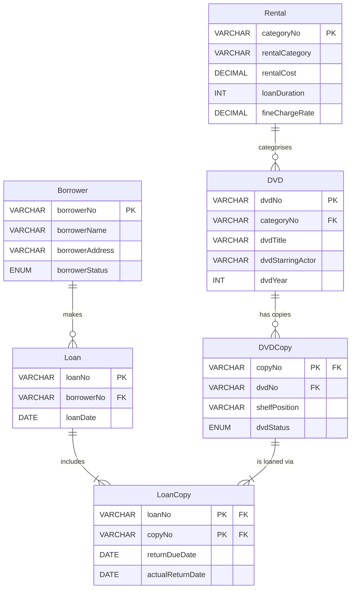

### DVD Loan Management System

--------------------------------------------------------

The DVD Loan Management System represents a DVD rental service through a structured database containing borrower details, DVD information, rental categories, physical DVD copies and loan records. Each table stores specific information, with relationships linking borrowers to their loans and connecting individual DVD copies to their corresponding titles. The database includes sample records to represent different borrowing situations, DVD availability statuses and return dates. It also supports queries that combine information from multiple tables to examine loan activity and borrower records. Together, these components provide a practical example of how a database can represent and manage the information involved in a DVD lending service.

----------------------------------------------------------------

### Table Of Contents

-----------------------------------------

1. [Introduction](#introduction)

2. [Database Normalisation](#database-normalisation)
   
   [1NF](#1nf)
   
   [2NF](#2nf)
   
   [3NF](#3nf)

3. [Normalisation](#normalisation)

4. [Entity Relationship Diagram](#entity-relationship-diagram)

5. [DDL SQL Statement](#ddl-sql-statement)

6. [References](#references)

7. [Citation](#citation)

--------------------------------------------------------

### Introduction

---------------------------------------------------------------------------------------------

This assignment focuses on the design and development of a DVD Loan Management System, demonstrating how database concepts are applied in a real world scenario. The main aim is to organise data efficiently while ensuring accuracy, consistency, and ease of access for users. A key part of this process is database normalisation, which helps to reduce redundancy and improve the overall structure of the system. Throughout this work, the database is progressively refined from unnormalised data into First, Second, and Third Normal Forms (1NF, 2NF, and 3NF). This step by step approach highlights how complex data can be broken down into smaller, well structured tables.

In addition, an Entity Relationship Diagram (ERD) is used to visually represent the relationships between different entities within the system. The assignment also includes the implementation phase, where SQL is used to create tables, insert data, and perform queries. These queries demonstrate how the database can be used to retrieve meaningful information, such as tracking loans, identifying overdue items, and managing customer records. Overall, this work showcases both the theoretical and practical aspects of database design, providing a clear understanding of how structured data systems operate in practice.

---

### Database Normalisation

---

##### 1NF

<u>Loan</u>

| **Loan No. (PK)** | **Borrower No.** | **Borrower Name** | **Borrower Address**            | **Borrower Total Fine** | **Borrower Status** | **Loan Date** | **Total loan Cost** |
| ----------------- | ---------------- | ----------------- | ------------------------------- | ----------------------- | ------------------- | ------------- | ------------------- |
| LN74857           | BN1721           | Ben Jones         | 28 Low Road, Nottingham NG5 3PB | £0.00                   | Allowed             | 06/02/2002    | £8.00               |

<u>DVD_Details</u>

| **Loan No. (PK, FK)** | **Copy No. (PK)** | **DVD No.** | **DVD Title**           | **DVD Starring Actor** | **DVD Year** | **Rental Category** | **Rental Cost** | **Shelf Position** | **DVD Status** | **Return Due Date** |
| --------------------- | ----------------- | ----------- | ----------------------- | ---------------------- | ------------ | ------------------- | --------------- | ------------------ | -------------- | ------------------- |
| LN74857               | CN1099            | DN198       | Raiders of the Lost Ark | Harrison Ford          | 1981         | Adventure           | £3.50           | AV123              | On Loan        | 13/02/2002          |
| LN74857               | CN8739            | DN9829      | John Wick               | Keanu Reeves           | 2014         | Action              | £4.50           | AC8728             | On Loan        | 13/02/2002          |

##### 2NF

<u>Borrower</u>

| **Borrower No. (PK)** | **Borrower Name** | **Borrower Address**            | **Borrower Status** | **Borrower Total Fine** |
| --------------------- | ----------------- | ------------------------------- | ------------------- | ----------------------- |
| BN1721                | Ben Jones         | 28 Low Road, Nottingham NG5 3PB | Allowed             | £0.00                   |

<u>Loan_Copy</u>

| **Loan No. (PK) (FK)** | **Copy No. (PK) (FK)** | **Return Due Date** | **Actual Return Date** | **Loan Fine Charge** |
| ---------------------- | ---------------------- | ------------------- | ---------------------- | -------------------- |
| LN74857                | CN1099                 | 13/02/2002          | 13/02/2002             | £0.00                |
| LN74857                | CN8739                 | 13/02/2002          | 13/02/2002             | £0.00                |

<u>DVD_Copy</u>

| **DVD No. (PK)** | **Copy No. (FK)** | **Shelf Position** | **DVD Status** |
| ---------------- | ----------------- | ------------------ | -------------- |
| DN198            | CN1099            | AV123              | On Loan        |
| DN9829           | CN8739            | AC8728             | On Loan        |

<u>DVD</u>

| **DVD No. (PK)** | **DVD Title**           | **DVD Starring Actor** | **DVD Year** | **Category No. (FK)** | **Rental Category** | **Rental Cost** |
| ---------------- | ----------------------- | ---------------------- | ------------ | --------------------- | ------------------- | --------------- |
| DN198            | Raiders of the Lost Ark | Harrison Ford          | 1981         | CAT1                  | Adventure           | £3.50           |
| DN9829           | John Wick               | Keanu Reeves           | 2014         | CAT2                  | Action              | £4.50           |

<u>Loan</u>

| **Loan No. (FK)** | **Borrower No. (FK)** | **Loan Date** | **Total loan Cost** |
| ----------------- | --------------------- | ------------- | ------------------- |
| LN74857           | BN1721                | 06/02/2002    | £8.00               |

##### 3NF

<u>Borrower</u>

| **Borrower No. (PK)** | **Borrower Name** | **Borrower Address**            | **Borrower Status** |
| --------------------- | ----------------- | ------------------------------- | ------------------- |
| BN1721                | Ben Jones         | 28 Low Road, Nottingham NG5 3PB | Allowed             |

<u>Loan</u>

| **Loan No. (PK)** | **Borrower No. (FK)** | **Loan Date** |
| ----------------- | --------------------- | ------------- |
| LN74857           | BN1721                | 06/02/2002    |

<u>Loan_Copy</u>

| **Loan No. (PK) (FK)** | **Copy No. (PK) (FK)** | **Return Due Date** | **Actual Return Date** |
| ---------------------- | ---------------------- | ------------------- | ---------------------- |
| LN74857                | CN1099                 | 13/02/2002          | 13/02/2002             |
| LN74857                | CN8739                 | 13/02/2002          | 14/02/2002             |

<u>DVD_Copy</u>

| **Copy No. (PK) (FK)** | **DVD No. (FK)** | **Shelf Position** | **DVD Status** |
| ---------------------- | ---------------- | ------------------ | -------------- |
| CN1099                 | DN198            | AV123              | On Loan        |
| CN8739                 | DN9829           | AC8728             | On Loan        |

<u>DVD</u>

| **DVD No. (PK)** | **Category No. (FK)** | **DVD Title**           | **DVD Starring Actor** | **DVD Year** |
| ---------------- | --------------------- | ----------------------- | ---------------------- | ------------ |
| DN198            | CAT1                  | Raiders of the Lost Ark | Harrison Ford          | 1981         |
| DN9829           | CAT2                  | John Wick               | Keanu Reeves           | 2014         |

<u>Rental</u>

| **Category No. (PK)** | **Rental Category** | **Rental Cost** | **Loan Duration** | **Fine Charge Rate** |
| --------------------- | ------------------- | --------------- | ----------------- | -------------------- |
| CAT1                  | Adventure           | £3.50           | 3                 | £0.50                |
| CAT2                  | Action              | £4.50           | 7                 | £1.00                |

---

### Normalisation

---

Normalization is the process of organizing a database to reduce redundancy and dependency. Therefore, this ensures that each piece of data is stored in one place. According to Ada Computer Science (n.d.), the strategic way for Normalisation is reducing data duplication while constructing data structures, which also improves data integrity. This allows the data to be accessed using queries in an effective manner. According to Computer Science Cafe (n.d.), going through the steps of normalisation your database should be more efficient and incorrect or redundant data should be eliminated.

**<u>Advantages of Normalisation</u>**

Efficiency is achieved my splitting data into smaller tables into normal forms; this increases accuracy and as well as dependency. According to GeeksforGeeks (2025), Normalisation stores each data item only once, preventing duplication therefore saves storage space and avoids unnecessary repetition. In the DVD Loan Management System, data of the Borrower and the DVD is stored once. The use of 1NF, 2NF and 3NF of the DVD loan Management System ensures data remains accurate and reliable.

<u><strong>Disadvantages of Normalisation</strong></u>

Reducing redundancy can often lead to slower performance there are multiple complex tables of normalised forms as time is required for grouping unnormalised table to normalised. According to GeeksforGeeks (2025), Designing normalised databases requires deep understanding of data relationships. Example is the relationships between 1NF and 2NF, there can be time consuming to accurately related both tables to create 3NF. Business reports often need data from several related tables. Inserting new data may involve multiple tables.

---

### Entity Relationship Diagram

--------------------------



------------------------------------------------------

### DDL SQL Statement

---

```sql
CREATE DATABASE DVD_Loan_System;
USE DVD_Loan_System;

-- TABLE 1: BORROWER

CREATE TABLE Borrower (
    BorrowerNo VARCHAR(10) PRIMARY KEY,
    BorrowerName VARCHAR(255) NOT NULL,
    BorrowerAddress VARCHAR(255) NOT NULL,
    BorrowerStatus ENUM('Allowed', 'Suspended', 'Banned', 'Pending') NOT NULL DEFAULT 'Allowed'
);

INSERT INTO Borrower (BorrowerNo, BorrowerName, BorrowerAddress, BorrowerStatus) VALUES
('BN2824', 'Ben Jones',      '28 Low Road, Nottingham NG5 3PB',        'Allowed'),
('BN1409', 'Sarah Mitchell', '14 Oak Avenue, Derby DE1 2LQ',           'Allowed'),
('BN5506', 'James Carter',   '7 Maple Street, Leicester LE3 5RY',      'Allowed'),
('BN5012', 'Priya Sharma',   '33 Birchwood Lane, Nottingham NG7 4TW',  'Allowed'),
('BN4657', 'Daniel Hughes',  '9 Elm Close, Loughborough LE11 2AS',     'Suspended'),
('BN3286', 'Emma Thompson',  '52 Riverside Drive, Derby DE21 6PH',     'Allowed'),
('BN2679', 'Omar Ali',       '18 Chestnut Road, Nottingham NG3 1BK',   'Allowed'),
('BN9935', 'Lucy Evans',     '41 Parkside View, Leicester LE2 3SD',    'Banned'),
('BN2424', 'Michael Brown',  '6 Holly Court, Beeston NG9 2WA',         'Allowed'),
('BN7912', 'Fatima Malik',   '29 Cedar Way, Nottingham NG6 8MN',       'Allowed'),
('BN1520', 'Ryan O Brien',   '3 Willow Bank, Derby DE3 9JT',           'Allowed'),
('BN1488', 'Chloe Walker',   '77 Hazel Grove, Loughborough LE12 5QP',  'Pending'),
('BN2535', 'Aisha Patel',    '15 Poplar Lane, Nottingham NG8 6KL',     'Suspended'),
('BN4582', 'Tom Richards',   '22 Beech Drive, Leicester LE5 4RP',      'Allowed'),
('BN4811', 'Zara Khan',      '8 Sycamore Close, Nottingham NG2 7HX',   'Banned'),
('BN9279', 'Liam Foster',    '31 Ash Road, Nottingham NG1 2PL',        'Allowed'),
('BN1434', 'Grace Okafor',   '19 Cherry Lane, Derby DE4 3NM',          'Allowed'),
('BN4257', 'Noah Williams',  '5 Fern Close, Leicester LE7 9WQ',        'Pending'),
('BN9928', 'Amara Diallo',   '44 Spruce Drive, Nottingham NG4 5JH',    'Allowed'),
('BN7873', 'Jack Harrison',  '12 Pine Street, Beeston NG9 1RT',        'Allowed'),
('BN4611', 'Isla Murray',    '67 Magnolia Way, Derby DE2 8KP',         'Suspended'),
('BN8359', 'Ethan Clarke',   '3 Rowan Avenue, Loughborough LE11 7SD',  'Allowed'),
('BN5557', 'Sofia Reyes',    '28 Willow Court, Nottingham NG6 3BX',    'Allowed'),
('BN1106', 'Harry Singh',    '9 Oakfield Road, Leicester LE4 2WN',     'Banned'),
('BN3615', 'Mia Johnson',    '55 Beech Close, Nottingham NG8 9TR',     'Allowed'),
('BN7924', 'Oliver Patel',   '21 Elm Way, Derby DE5 1QA',              'Pending'),
('BN6574', 'Amelia White',   '14 Cedar Avenue, Nottingham NG3 7LK',    'Pending'),
('BN5552', 'George Thomas',  '38 Sycamore Road, Leicester LE6 4DP',    'Allowed'),
('BN3547', 'Poppy Green',    '7 Birch Lane, Beeston NG9 4MV',          'Allowed'),
('BN4527', 'Charlie Adams',  '26 Hawthorn Drive, Nottingham NG7 2SB',  'Suspended');

SELECT * FROM Borrower;

-- TABLE 2: RENTAL

CREATE TABLE Rental (
    CategoryNo VARCHAR(10) PRIMARY KEY,
    RentalCategory VARCHAR(255) NOT NULL,
    RentalCost DECIMAL(4,2) NOT NULL,
    LoanDuration INT NOT NULL,
    FineChargeRate DECIMAL(4,2) NOT NULL
);

INSERT INTO Rental (CategoryNo, RentalCategory, RentalCost, LoanDuration, FineChargeRate) VALUES
('CAT881', 'Action',    4.00, 7, 0.75),
('CAT444', 'Adventure', 3.50, 7, 0.50),
('CAT204', 'Animation', 3.50, 3, 0.50),
('CAT194', 'Biography', 3.80, 1, 0.20),
('CAT489', 'Comedy',    4.50, 7, 0.75),
('CAT199', 'Crime',     3.80, 3, 0.60),
('CAT467', 'Drama',     4.20, 7, 0.75),
('CAT967', 'Horror',    4.00, 3, 0.75),
('CAT452', 'Superhero', 4.50, 7, 1.00),
('CAT718', 'Thriller',  4.00, 3, 0.75);


SELECT * FROM Rental;

-- TABLE 3: DVD

CREATE TABLE DVD (
    DvdNo VARCHAR(10) PRIMARY KEY,
    DvdTitle VARCHAR(255) NOT NULL,
    StarringActor VARCHAR(255) NOT NULL,
    DvdYear YEAR NULL,
    CategoryNo VARCHAR(10),
    FOREIGN KEY (CategoryNo) REFERENCES Rental (CategoryNo)
);

INSERT INTO DVD (DvdNo, DvdTitle, StarringActor, DvdYear, CategoryNo) VALUES
('DN5333', 'La La Land',                              'Ryan Gosling',         2016, 'CAT489'),
('DN1711', 'Prometheus',                              'Noomi Rapace',         2012, 'CAT444'),
('DN8527', 'Guardians of the Galaxy',                 'Chris Pratt',          2014, 'CAT452'),
('DN9785', 'Split',                                   'James McAvoy',         2016, 'CAT967'),
('DN3045', 'Arrival',                                 'Amy Adams',            2016, 'CAT467'),
('DN7201', 'Gone Girl',                               'Ben Affleck',          2014, 'CAT199'),
('DN2291', 'Moana',                                   'Aulii Cravalho',       2016, 'CAT204'),
('DN5803', 'Passengers',                              'Jennifer Lawrence',    2016, 'CAT444'),
('DN6925', 'Moonlight',                               'Mahershala Ali',       2016, 'CAT467'),
('DN4150', 'Fantastic Beasts and Where to Find Them', 'Eddie Redmayne',       2016, 'CAT444'),
('DN2139', 'Toy Story',                               'Tom Hanks',            1995, 'CAT204'),
('DN1750', 'Suicide Squad',                           'Will Smith',           2016, 'CAT452'),
('DN4733', 'The Hateful Eight',                       'Samuel L. Jackson',    2015, 'CAT199'),
('DN5741', 'The Edge of Seventeen',                   'Hailee Steinfeld',     2016, 'CAT489'),
('DN2307', 'Interstellar',                            'Matthew McConaughey',  2014, 'CAT444'),
('DN4814', 'Black Panther',                           'Chadwick Boseman',     2018, 'CAT452'),
('DN2654', 'The Prestige',                            'Christian Bale',       2006, 'CAT467'),
('DN7227', 'Bad Moms',                                'Mila Kunis',           2016, 'CAT489'),
('DN5554', 'Shutter Island',                          'Leonardo DiCaprio',    2010, 'CAT199'),
('DN8428', 'Finding Nemo',                            'Albert Brooks',        2003, 'CAT204'),
('DN6977', 'Doctor Strange',                          'Benedict Cumberbatch', 2016, 'CAT452'),
('DN3664', 'Why Him?',                                'Zoey Deutch',          2016, 'CAT489'),
('DN7065', 'The Departed',                            'Leonardo DiCaprio',    2006, 'CAT199'),
('DN6820', 'Frozen',                                  'Idina Menzel',         2013, 'CAT204'),
('DN4432', 'Mamma Mia!',                              'Meryl Streep',         2008, 'CAT489'),
('DN5374', 'X-Men: Apocalypse',                       'James McAvoy',         2016, 'CAT452'),
('DN2169', 'Prisoners',                               'Hugh Jackman',         2013, 'CAT199'),
('DN3803', 'Manchester by the Sea',                   'Casey Affleck',        2016, 'CAT467'),
('DN9751', 'Superbad',                                'Michael Cera',         2007, 'CAT489'),
('DN5010', 'The Secret Life of Pets',                 'Louis C.K.',           2016, 'CAT204'),
('DN3677', 'Inglourious Basterds',                    'Brad Pitt',            2009, 'CAT444'),
('DN8573', 'The Intern',                              'Robert De Niro',       2015, 'CAT489'),
('DN7216', 'Nocturnal Animals',                       'Amy Adams',            2016, 'CAT467'),
('DN5422', 'Diary of a Wimpy Kid',                    'Zachary Gordon',       2010, 'CAT489'),
('DN4598', 'The Help',                                'Emma Stone',           2011, 'CAT467'),
('DN6313', 'The Great Wall',                          'Matt Damon',           2016, 'CAT881'),
('DN1916', 'Bahubali: The Beginning',                 'Prabhas',              2015, 'CAT881'),
('DN4752', 'Hacksaw Ridge',                           'Andrew Garfield',      2016, 'CAT194'),
('DN1525', 'Lion',                                    'Dev Patel',            2016, 'CAT467'),
('DN6168', 'Mindhorn',                                'Essie Davis',          2016, 'CAT489'),
('DN7572', 'Captain America: Civil War',              'Chris Evans',          2016, 'CAT452'),
('DN5386', 'Deadpool',                                'Ryan Reynolds',        2016, 'CAT452'),
('DN2084', 'Crazy Stupid Love',                       'Steve Carell',         2011, 'CAT489'),
('DN4456', 'Trainwreck',                              'Amy Schumer',          2015, 'CAT489'),
('DN6155', 'The Big Short',                           'Christian Bale',       2015, 'CAT194');

SELECT * FROM DVD;

-- TABLE 4: DVD COPY

CREATE TABLE DvdCopy (
    CopyNo VARCHAR(10) PRIMARY KEY,
    DvdNo VARCHAR(10),
    FOREIGN KEY (DvdNo) REFERENCES DVD (DvdNo),
    ShelfPosition VARCHAR(255) NOT NULL,
    DvdStatus ENUM('On Loan', 'Available', 'Reserved', 'Retired') NOT NULL DEFAULT 'Available'
);

INSERT INTO DvdCopy (CopyNo, DvdNo, ShelfPosition, DvdStatus) VALUES
('CN4483', 'DN5333', 'AA101', 'On Loan'),
('CN9179', 'DN1711', 'AA102', 'Available'),
('CN7482', 'DN8527', 'AA103', 'On Loan'),
('CN8517', 'DN9785', 'AA104', 'Available'),
('CN3340', 'DN3045', 'AA105', 'On Loan'),
('CN5339', 'DN7201', 'AA106', 'Available'),
('CN3287', 'DN2291', 'AA107', 'On Loan'),
('CN5040', 'DN5803', 'AA108', 'Available'),
('CN9830', 'DN6925', 'AB101', 'On Loan'),
('CN5304', 'DN4150', 'AB102', 'Reserved'),
('CN8019', 'DN2139', 'AB103', 'On Loan'),
('CN7543', 'DN1750', 'AB104', 'Available'),
('CN6930', 'DN4733', 'AB105', 'On Loan'),
('CN4593', 'DN5741', 'AB106', 'Available'),
('CN3266', 'DN2307', 'AB107', 'On Loan'),
('CN9348', 'DN4814', 'AC101', 'On Loan'),
('CN9085', 'DN2654', 'AC102', 'Reserved'),
('CN2489', 'DN7227', 'AC103', 'On Loan'),
('CN1771', 'DN5554', 'AC104', 'Available'),
('CN2796', 'DN8428', 'AC105', 'On Loan'),
('CN3504', 'DN6977', 'AC106', 'Available'),
('CN3621', 'DN3664', 'AC107', 'On Loan'),
('CN7916', 'DN7065', 'AD101', 'Available'),
('CN2040', 'DN6820', 'AD102', 'On Loan'),
('CN7304', 'DN4432', 'AD103', 'Retired'),
('CN7252', 'DN5374', 'AD104', 'Available'),
('CN8668', 'DN2169', 'AD105', 'On Loan'),
('CN9669', 'DN3803', 'AE101', 'On Loan'),
('CN5119', 'DN9751', 'AE102', 'Available'),
('CN1188', 'DN5010', 'AE103', 'On Loan'),
('CN2876', 'DN3677', 'AE104', 'Available'),
('CN9797', 'DN8573', 'AE105', 'On Loan'),
('CN5371', 'DN7216', 'AF101', 'Available'),
('CN6573', 'DN5422', 'AF102', 'On Loan'),
('CN2827', 'DN4598', 'AF103', 'Available'),
('CN5808', 'DN6313', 'AF104', 'Available'),
('CN8123', 'DN1916', 'AF105', 'On Loan'),
('CN3591', 'DN4752', 'AF106', 'Retired'),
('CN8433', 'DN1525', 'AF107', 'On Loan'),
('CN1053', 'DN6168', 'AF108', 'Available'),
('CN5315', 'DN7572', 'AG101', 'On Loan'),
('CN9201', 'DN5386', 'AG102', 'Available'),
('CN3927', 'DN2084', 'AG103', 'Reserved'),
('CN9317', 'DN4456', 'AG104', 'On Loan'),
('CN2743', 'DN6155', 'AG105', 'Available');

SELECT * FROM DvdCopy;

-- TABLE 5: LOAN

CREATE TABLE Loan (
    LoanNo VARCHAR(10) PRIMARY KEY,
    BorrowerNo VARCHAR(10),
    FOREIGN KEY (BorrowerNo) REFERENCES Borrower (BorrowerNo),
    LoanDate DATETIME DEFAULT CURRENT_TIMESTAMP NOT NULL
);

INSERT INTO Loan (LoanNo, BorrowerNo, LoanDate) VALUES
('LN5889', 'BN2824', '2025-01-10 10:00:00'),
('LN9317', 'BN1409', '2025-01-15 11:30:00'),
('LN4258', 'BN5506', '2025-01-20 09:45:00'),
('LN3504', 'BN5012', '2025-02-01 14:00:00'),
('LN7126', 'BN3286', '2025-02-05 16:20:00'),
('LN3646', 'BN2679', '2025-02-10 10:10:00'),
('LN9837', 'BN2424', '2025-02-14 13:30:00'),
('LN9689', 'BN7912', '2025-02-20 09:00:00'),
('LN1009', 'BN1520', '2025-03-01 11:00:00'),
('LN6310', 'BN2535', '2025-03-05 15:45:00'),
('LN9005', 'BN4582', '2025-03-10 10:30:00'),
('LN1319', 'BN9279', '2025-03-15 14:15:00'),
('LN2832', 'BN1434', '2025-03-20 09:20:00'),
('LN6947', 'BN9928', '2025-04-01 11:40:00'),
('LN6038', 'BN7873', '2025-04-05 13:00:00'),
('LN4923', 'BN8359', '2025-04-10 10:50:00'),
('LN1949', 'BN5557', '2025-04-15 15:30:00'),
('LN4946', 'BN1106', '2025-04-20 09:10:00'),
('LN2290', 'BN3615', '2025-04-25 14:00:00'),
('LN2403', 'BN6574', '2025-05-01 11:20:00'),
('LN8962', 'BN2824', '2025-05-05 10:00:00'),
('LN2133', 'BN1409', '2025-05-10 13:15:00'),
('LN9727', 'BN5506', '2025-05-14 09:30:00'),
('LN3060', 'BN5012', '2025-05-18 15:00:00'),
('LN3103', 'BN3286', '2025-05-22 11:45:00'),
('LN8787', 'BN2424', '2025-05-26 10:20:00'),
('LN3705', 'BN7912', '2025-06-01 14:30:00'),
('LN5342', 'BN2535', '2025-06-05 09:00:00'),
('LN9645', 'BN9279', '2025-06-10 11:10:00'),
('LN7932', 'BN9928', '2025-06-14 13:40:00');

SELECT * FROM Loan;

-- TABLE 6: LOAN COPY

CREATE TABLE LoanCopy (
    LoanNo VARCHAR(10),
    CopyNo VARCHAR(10),
    PRIMARY KEY (LoanNo, CopyNo),
    FOREIGN KEY (LoanNo) REFERENCES Loan (LoanNo),
    FOREIGN KEY (CopyNo) REFERENCES DvdCopy (CopyNo),
    ReturnDueDate DATETIME NOT NULL,
    ActualReturnDate DATETIME NULL
);

INSERT INTO LoanCopy (LoanNo, CopyNo, ReturnDueDate, ActualReturnDate) VALUES
('LN5889', 'CN9830', '2025-01-17 10:00:00', '2025-01-17 09:00:00'),
('LN9317', 'CN9348', '2025-01-22 10:00:00', '2025-01-23 11:00:00'),
('LN4258', 'CN7916', '2025-01-27 11:30:00', '2025-01-27 10:00:00'),
('LN3504', 'CN5371', '2025-01-27 11:30:00', '2025-01-29 14:00:00'),
('LN7126', 'CN8019', '2025-02-12 09:45:00', '2025-02-12 09:00:00'),
('LN3646', 'CN9669', '2025-02-17 09:45:00', '2025-02-19 10:00:00'),
('LN9837', 'CN6930', '2025-02-21 14:00:00', '2025-02-21 13:00:00'),
('LN9689', 'CN9797', '2025-02-27 14:00:00', '2025-02-28 15:00:00'),
('LN1009', 'CN9085', '2025-03-08 16:20:00', '2025-03-08 15:00:00'),
('LN6310', 'CN8123', '2025-03-12 16:20:00', '2025-03-14 10:00:00'),
('LN9005', 'CN2040', '2025-03-17 10:10:00', '2025-03-17 09:00:00'),
('LN1319', 'CN5315', '2025-03-22 10:10:00', '2025-03-24 11:00:00'),
('LN2832', 'CN2489', '2025-03-27 13:30:00', '2025-03-27 12:00:00'),
('LN6947', 'CN6573', '2025-04-08 13:30:00', '2025-04-10 09:00:00'),
('LN6038', 'CN7304', '2025-02-27 09:00:00', '2025-02-27 09:00:00'),
('LN4923', 'CN9317', '2025-03-17 09:00:00', '2025-03-18 09:00:00'),
('LN1949', 'CN5304', '2025-03-22 11:00:00', '2025-03-23 10:00:00'),
('LN4946', 'CN5119', '2025-03-27 11:00:00', '2025-03-27 09:00:00'),
('LN2290', 'CN1771', '2025-04-01 15:45:00', '2025-04-02 11:00:00'),
('LN2403', 'CN3591', '2025-04-08 15:45:00', '2025-04-08 09:00:00'),
('LN8962', 'CN7543', '2025-04-08 11:00:00', '2025-04-10 09:00:00'),
('LN2133', 'CN1188', '2025-04-10 11:00:00', '2025-04-10 09:00:00'),
('LN9727', 'CN2796', '2025-05-21 14:15:00', '2025-05-21 13:00:00'),
('LN3060', 'CN2743', '2025-05-25 14:15:00', '2025-05-28 10:00:00'),
('LN3103', 'CN7252', '2025-05-29 09:20:00', '2025-05-29 08:00:00'),
('LN8787', 'CN8433', '2025-06-02 09:20:00', '2025-06-05 11:00:00'),
('LN3705', 'CN4593', '2025-06-08 11:40:00', '2025-06-08 10:00:00'),
('LN5342', 'CN2876', '2025-06-08 11:40:00', '2025-06-10 09:00:00'),
('LN9645', 'CN3504', '2025-06-17 13:00:00', '2025-06-17 12:00:00'),
('LN7932', 'CN3621', '2025-06-21 14:00:00', '2025-06-22 09:00:00');

SELECT * FROM LoanCopy;

SQL Command to Adapt Data

-- Query 1----------------------------------------------

SELECT DISTINCT
    b.BorrowerNo,
    b.BorrowerName,
    b.BorrowerAddress,
    b.BorrowerStatus
FROM Borrower AS b
JOIN Loan AS l ON l.BorrowerNo = b.BorrowerNo
JOIN LoanCopy AS lc ON lc.LoanNo = l.LoanNo
WHERE lc.ActualReturnDate IS NULL
ORDER BY SUBSTRING_INDEX(b.BorrowerName, ' ', -1);

-- Query 2---------------------------------------------

SELECT
    b.BorrowerNo,
    b.BorrowerName,
    b.BorrowerAddress,
    lc.ReturnDueDate,
    DATEDIFF(CURDATE(), lc.ReturnDueDate) AS DaysOverdue
FROM Borrower AS b
JOIN Loan AS l ON l.BorrowerNo = b.BorrowerNo
JOIN LoanCopy AS lc ON lc.LoanNo = l.LoanNo
WHERE lc.ActualReturnDate IS NULL
AND lc.ReturnDueDate < CURDATE()
ORDER BY DaysOverdue DESC;

-- Query 3----------------------------------------------

SELECT
    b.BorrowerNo,
    b.BorrowerName,
    b.BorrowerAddress,
    d.DvdTitle,
    d.StarringActor,
    d.DvdYear,
    l.LoanDate
FROM Borrower AS b
JOIN Loan AS l ON l.BorrowerNo = b.BorrowerNo
JOIN LoanCopy AS lc ON lc.LoanNo = l.LoanNo
JOIN DvdCopy AS dc ON dc.CopyNo = lc.CopyNo
JOIN DVD AS d ON d.DvdNo = dc.DvdNo
JOIN Rental AS r ON r.CategoryNo  = d.CategoryNo
WHERE r.RentalCategory = 'Comedy'
AND l.LoanDate >= DATE_SUB(CURDATE(), INTERVAL 4 WEEK)
ORDER BY b.BorrowerName;

-- Query 4----------------------------------------------

SELECT
    b.BorrowerNo,
    b.BorrowerName,
    b.BorrowerAddress,
    b.BorrowerStatus,
    SUM(
        DATEDIFF(CURDATE(), lc.ReturnDueDate)
        * r.FineChargeRate
    ) AS TotalFinesOwed
FROM  Borrower AS b
JOIN  Loan AS l ON l.BorrowerNo  = b.BorrowerNo
JOIN LoanCopy AS lc ON lc.LoanNo     = l.LoanNo
JOIN DvdCopy  AS dc ON dc.CopyNo     = lc.CopyNo
JOIN DVD AS d ON d.DvdNo       = dc.DvdNo
JOIN Rental AS r ON r.CategoryNo  = d.CategoryNo
WHERE lc.ActualReturnDate IS NULL
AND lc.ReturnDueDate < CURDATE()
GROUP BY b.BorrowerNo,
         b.BorrowerName,
         b.BorrowerAddress,
         b.BorrowerStatus
ORDER BY TotalFinesOwed DESC
LIMIT 1;

-- Query 5----------------------------------------------

UPDATE Rental AS r
JOIN DVD AS d ON d.CategoryNo = r.CategoryNo
SET r.RentalCost = 5.50
WHERE r.RentalCategory = 'Superhero'
AND d.DvdYear >= 2015;

-- Verify the update applied correctly
SELECT
    d.DvdNo,
    d.DvdTitle,
    d.DvdYear,
    r.RentalCategory,
    r.RentalCost
FROM DVD AS d
JOIN Rental AS r ON r.CategoryNo = d.CategoryNo
WHERE r.RentalCategory = 'Superhero'
AND d.DvdYear >= 2015;

-- Query 6----------------------------------------------

DELETE FROM DvdCopy
WHERE  DvdNo IN (
    SELECT DvdNo
    FROM  DVD
    WHERE DvdNo NOT IN (
        SELECT DISTINCT dc.DvdNo
        FROM DvdCopy  AS dc
        JOIN LoanCopy AS lc ON lc.CopyNo = dc.CopyNo
    )
);

DELETE FROM DVD
WHERE  DvdNo NOT IN (
    SELECT DISTINCT dc.DvdNo
    FROM  DvdCopy  AS dc
    JOIN  LoanCopy AS lc ON lc.CopyNo = dc.CopyNo
);

SELECT
    d.DvdNo,
    d.DvdTitle,
    COUNT(lc.LoanNo) AS TotalLoans
FROM DVD AS d
JOIN DvdCopy AS dc ON dc.DvdNo  = d.DvdNo
JOIN LoanCopy AS lc ON lc.CopyNo = dc.CopyNo
GROUP BY d.DvdNo,
        d.DvdTitle
ORDER BY d.DvdTitle;
```

---

### References

---

Ada Computer Science (n.d.). Normalisation. Retrieved from: [Ada Computer Science](https://adacomputerscience.org/concepts/dbs_normalisation) [Accessed 3 March 2026].

GeeksforGeeks (2025, July 23). Advantages and Disadvantages of Normalization. Retrieved from: [Advantages and Disadvantages of Normalization - GeeksforGeeks](https://www.geeksforgeeks.org/dbms/advantages-and-disadvantages-of-normalization) [Accessed 3 March 2026].

Computer Science Cafe (n.d.). What is a Normalisation. Retrieved from: https://www.computersciencecafe.com/73-normalisation.html [Accessed 10 March 2026].

W3Schools (n.d.). SQL JOIN. Retrieved from: [SQL Joins](https://www.w3schools.com/sql/sql_join.asp) [Accessed 25 March 2026].

W3Schools (n.d.). SQL WHERE Clause. Retrieved from: [SQL WHERE Clause](https://www.w3schools.com/sql/sql_where.asp) [Accessed 25 March 2026].

W3Schools (n.d.). SQL BETWEEN Operator. Retrieved from: [SQL BETWEEN Operator](https://www.w3schools.com/sql/sql_between.asp) [Accessed 25 March 2026].

---

### Citation

---

***<u>IY455 Stage 1</u>***

| Assessment Details | Please Complete All Details             |
| ------------------ | --------------------------------------- |
| Group              | B                                       |
| Module Title       | Information Systems Analysis and Design |
| Assessment Type    | Coursework Final Submission             |
| Module Tutor Name  | Ghashim Mustafa                         |
| Student Name       | Deborah Mbithi                          |
| Student ID Number  | P510008                                 |

- [x] *I confirm that this assignment is my own work. Where I have referred to academic sources, I have provided in-text citations and included the sources in
  the final reference list.*

- [x] *Where I have used AI, I have cited and referenced appropriately.
